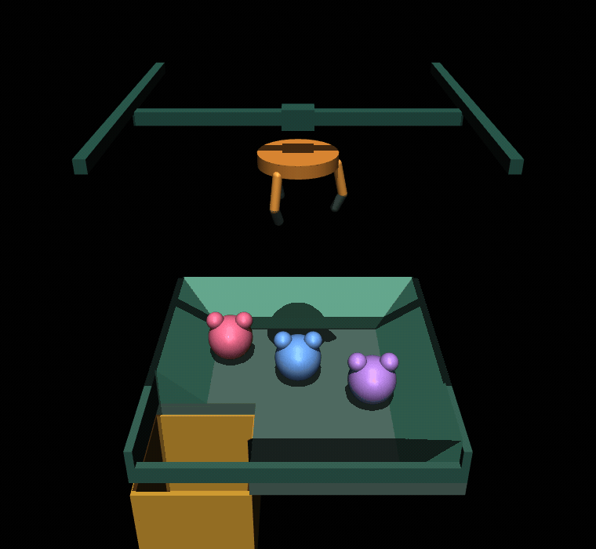

# PickDoll

MuJoCo로 만든 40cm 인형뽑기 프로토타입. 2주차 버전에서는 조준 후 Enter로 집기부터 회수함 배출까지 자동 진행한다.

## 데모



[2주차 결과 보고서](week-2-results.html) · [제작 계획서](mujoco-claw-project-plan.html) · [1주차 결과](week-1-results.html)

## Windows에서 실행

```powershell
python -m venv .venv
.\.venv\Scripts\python.exe -m pip install -r requirements.txt
.\.venv\Scripts\python.exe pickdoll.py
```

| 키 | 조작 |
| --- | --- |
| 방향키 | 앞뒤·좌우 이동 |
| Shift + 방향키 | 미세 조준 |
| Tab | 다섯 시점 순서대로 전환 |
| 1 / 2 / 3 / 4 / 5 | 정면 / 위 / 왼쪽 / 오른쪽 / 후면 시점으로 바로 전환 |
| Enter | 하강 → 집기 → 상승 → 회수함 이동 → 배출 |
| Q / E | 내리기 / 올리기 |
| Space | 집게 닫기 / 열기 |
| R / Esc | 초기화 / 종료 |

초기 상태에서는 파랑, 분홍, 보라 인형이 한 개씩 놓여 있다. 집게 바로 아래에 있는 파란 인형은 Enter로 바로 집을 수 있다. 다른 인형은 방향키로 조준한 뒤 Enter를 누른다. Space를 누르면 집게가 열려 인형이 떨어진다. R을 누르면 세 인형이 처음 위치로 돌아간다.

바닥의 초록색 점은 집게가 내려올 위치다. 위에서 보는 시점으로 바꾸면 집게와 인형의 평면 위치를 비교하기 쉽다. 방향키는 현재 화면 기준으로 움직인다. 시험 인형의 귀는 외형이고, 충돌은 둥근 몸통에서 일어난다.

수동으로 하려면 Q를 약 3초간 눌러 끝까지 내리고 Space로 닫은 뒤 E로 올린다. 자동 진행 중에는 수동 이동과 추가 뽑기 입력이 잠긴다. 24초 안에 동작이 끝나지 않으면 멈추고 R 초기화를 안내한다.

왼쪽 앞 상판의 구멍으로 인형을 떨어뜨리면 아래쪽 금색 회수함에 쌓이고 획득 수가 올라간다. R은 획득 수와 세 인형을 모두 초기화한다.

## 검증 결과

최종 배출 구조에서 초기화 없이 10판을 진행해 획득 3회와 실패 7회를 확인했다. 매 판 조작이 복귀했고 획득한 세 인형이 회수함에 남았다. 중복 뽑기 입력, 초기화와 동작 시간 초과도 확인했다. 집는 위치와 인형 자세에 따라 미끄러질 수 있다.
