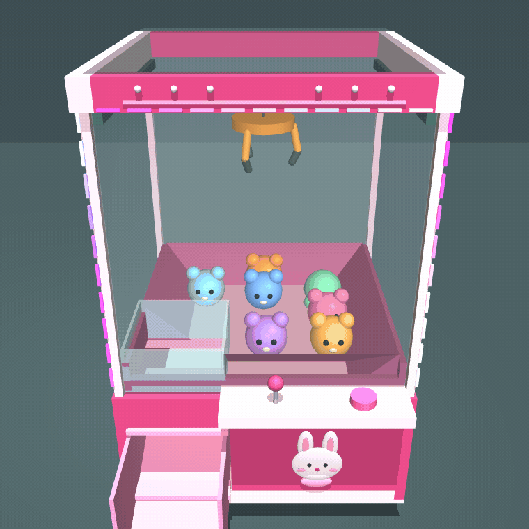

# PickDoll

MuJoCo로 만든 40cm 인형뽑기 프로토타입. 3주차 버전에서는 조준 후 Enter로 집기부터 회수함 배출까지 자동 진행한다.

## 데모



[3주차 결과 보고서](week-3-results.html) · [2주차 결과 보고서](week-2-results.html) · [제작 계획서](mujoco-claw-project-plan.html) · [안드로이드 제작 계획서](android-project-plan.html) · [1주차 결과](week-1-results.html)

## Windows에서 실행

```powershell
python -m venv .venv
.\.venv\Scripts\python.exe -m pip install -r requirements.txt
.\.venv\Scripts\python.exe pickdoll.py
```

| 키 | 조작 |
| --- | --- |
| 방향키 | 앞뒤·좌우 이동 |
| Shift + 방향키 | 초당 8mm로 천천히 조준 |
| Ctrl + 방향키 | 누를 때마다 1mm씩 조준 |
| Tab | 다섯 시점 순서대로 전환 |
| 1 / 2 / 3 / 4 / 5 | 정면 / 위 / 왼쪽 / 오른쪽 / 후면 시점으로 바로 전환 |
| Enter | 하강 → 집기 → 상승 → 회수함 이동 → 배출 |
| Z / X | 집게 전체를 반시계 / 시계 방향으로 회전 |
| Shift + Z / X | 느리게 회전 |
| Q / E | 내리기 / 올리기 |
| Space | 집게 닫기 / 열기 |
| N | 효과음 켜기 / 끄기 |
| M | 배경음악 켜기 / 끄기 |
| H | 수동 조작 안내 펼치기 / 접기 |
| R / Esc | 초기화 / 종료 |

초기 상태에서는 서로 다른 색의 인형 7개가 놓여 있다. 원하는 인형을 방향키로 조준한 뒤 Enter를 누른다. Space를 누르면 집게가 열려 인형이 떨어진다. R을 누르면 인형 7개가 새 위치에 배치된다.

바닥의 초록색 점은 집게가 내려올 위치다. 위에서 보는 시점으로 바꾸면 집게와 인형의 평면 위치를 비교하기 쉽다. 방향키는 현재 화면 기준으로 움직인다. 시험 인형의 귀는 외형이고, 충돌은 둥근 몸통에서 일어난다.

수동으로 하려면 Q를 약 3초간 눌러 끝까지 내리고 Space로 닫은 뒤 E로 올린다. 자동 진행 중에는 수동 이동과 추가 뽑기 입력이 잠긴다. 24초 안에 동작이 끝나지 않으면 멈추고 R 초기화를 안내한다.

왼쪽 앞 상판의 구멍으로 인형을 떨어뜨리면 경사 통로를 지나 기계 앞쪽 받침으로 나오고 획득 수가 올라간다. R은 획득 수와 인형 7개를 새 위치에 배치한다.

## 3주차 최종 마감

2026년 11월 19일 사용자 플레이 피드백을 반영해 현재 상태로 마감했다. 고정 난수 배치에서 10판을 연속 진행해 획득 7회와 실패 3회, 매 판 복귀를 확인했다. 미세 이동, 회전, LED, 초기화, 시간 초과와 음악·효과음 동시 재생도 검증했다. 별도의 처음 사용하는 손님 테스트 결과는 수집하지 않았다.

프레임과 캐비닛, 투명 충돌 벽, 회전 집게, 움직이는 조작부를 적용했다. 집게 줄은 시각 표현이며 승강은 슬라이드 관절로 계산한다. 인형은 둥근 강체다.

쉬운 집기를 위해 집게가 인형 중심에서 2.5cm 안에 있으면 Enter를 눌렀을 때 중심을 보정한 뒤 내려간다. 획득한 인형은 경사 통로를 타고 기계 앞쪽 받침으로 나온다. 낙하 구멍의 투명 가이드는 바닥에서 굴러 들어오는 인형을 막는다.

외장은 핑크 계열이며 전면과 양쪽 패널에 토끼 캐릭터를 배치했다. 방향키 입력과 Ctrl 미세 이동에 제어봉이 기울고, 자동 뽑기 중에는 버튼이 눌렸다가 동작 완료 후 올라온다.

상단 테두리와 앞쪽 기둥의 LED 띠는 분홍·보라·하늘색 계열로 색과 밝기가 천천히 흐른다.

인형은 총 7개이며 실행할 때와 R로 초기화할 때마다 위치가 무작위로 바뀐다. 획득 표시는 0 / 7로 시작한다.

집게는 수직축으로 좌우 180도까지 회전한다. 손가락 세 개는 부드러운 연동 제약으로 함께 닫히며, 벽이나 인형에 닿으면 닫히는 각도는 제한된다. 모서리에서는 Z/X로 발 사이의 빈 공간을 벽 쪽으로 돌린 뒤 집는다.

Windows에서는 실행할 때 약 34초 길이의 오리지널 벨 멜로디가 조용하게 반복 재생된다. M으로 켜고 끌 수 있고 창을 닫으면 음악도 멈춘다. 음악 파일은 assets/pickdoll-theme.wav에 포함되어 있다.

버튼 입력, 집게 닫힘, 획득 성공과 실패에 효과음이 재생된다. 성공하면 LED가 밝아지고 반짝이는 입자가 잠깐 나타난다. M은 배경음악, N은 효과음을 각각 켜고 끈다. 음악과 효과음은 프로젝트에서 직접 합성한 오리지널 음원이다.

## Further idea

- 웹 사이트로 배포해 PC와 휴대폰에서 링크로 플레이하기
- 모바일 조작을 확인한 뒤 안드로이드 앱으로 확장하기
- 바닥 면적 30 × 30cm의 실물 제품 검토하기

[Further idea 상세](week-3-results.html#further-idea)에 재사용 범위, 검토 사항과 실물 크기 가정을 정리했다. 후속 제작과 일정은 추후 정한다.

## Android / Unity 프로토타입

Unity 6.5 기반 Android 인형뽑기 프로토타입. 접촉 물리 집기·운반·놓기, 하강 중 미세 조정과 관성 회전을 구현했다. 4주차에는 구석 집기 형상·속도·감쇠와 그립 변동을 안정화했다. 5주차에는 하강 전 열림 확인, 자동 복귀·하부 배출·중복 없는 세션 획득을 구현했다. 6주차에는 짧고 넓게 열리는 집게와 감쇠 강화, 터치 조이스틱·큰 GRAB, 투명 상단·핀치 줌을 적용했다. PC 검증과 S26 실제 획득·갤럭시 탭 설치를 확인했다.

[Android 계획서](android-project-plan.html) · [Android 1주차 완료 보고서](android-week-1-results.html) · [Android 2주차 결과 보고서](android-week-2-results.html) · [Android 3주차 작업 결과](android-week-3-results.html) · [Android 4주차 안정화 결과](android-week-4-results.html) · [Android 5주차 자동 배출 결과](android-week-5-results.html) · [Android 6주차 집게·터치 조작 결과](android-week-6-results.html) · [Unity 실행 안내](Unity/README.md)
